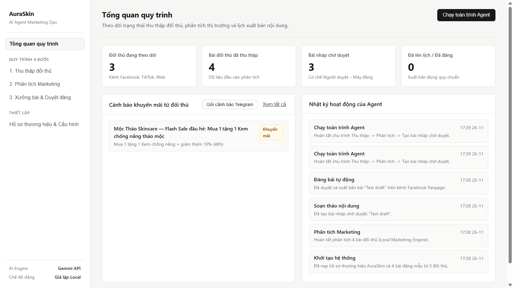
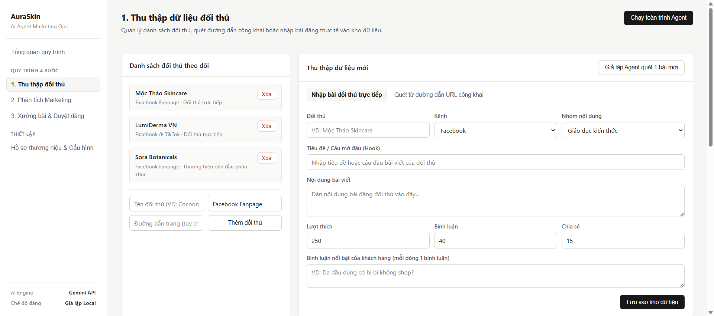
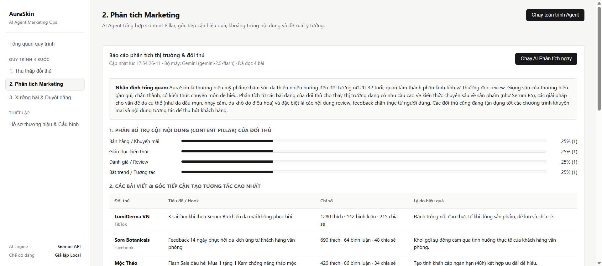
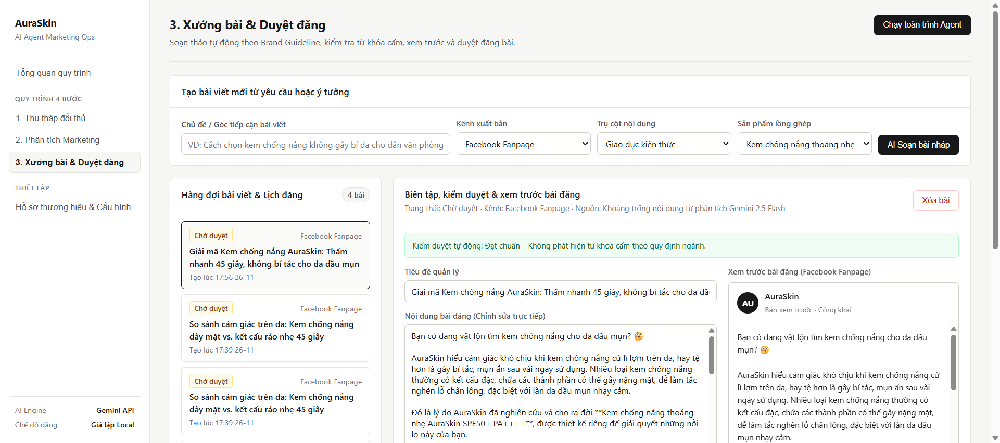
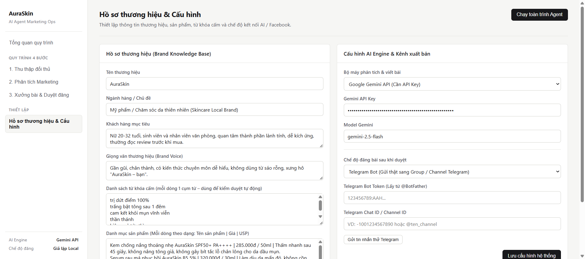

# Hệ thống AI Agent Marketing (Bản chạy Local)

Ứng dụng web chạy cục bộ phục vụ bài tập lớn và demo quy trình AI Agent Marketing theo mô hình Người duyệt - Máy tự đăng (Human-in-the-Loop).

Hệ thống gồm 4 bước chính:
1. Thu thập dữ liệu đối thủ: quản lý danh sách đối thủ, quét đường dẫn công khai (URL), nhập bài đối thủ hoặc tạo dữ liệu mẫu.
2. Phân tích Marketing: dùng Google Gemini API (hoặc bộ máy Local offline) để thống kê Content Pillar, lọc bài tương tác cao, tìm khoảng trống nội dung (Content Gap) từ bình luận khách hàng và gợi ý ý tưởng bài viết mới.
3. Soạn thảo và kiểm duyệt: tự viết bài Facebook/TikTok theo Brand Voice, kèm gợi ý hình ảnh (Visual Brief cho Designer), tự kiểm tra từ khóa cấm và xem trước giao diện bài đăng.
4. Duyệt và xuất bản: hỗ trợ 3 chế độ miễn phí gồm Giả lập Local, gửi thật qua Telegram Bot (gửi cảnh báo đối thủ và đăng bài), hoặc đăng lên Facebook Page (Graph API).

## 1. Cách khởi chạy trên máy cá nhân

Yêu cầu: máy đã cài Node.js (phiên bản 18 trở lên). Dự án không cần cài thêm thư viện ngoài.

Mở Terminal tại thư mục dự án và chạy:

```bash
node server.js
```

Sau đó mở trình duyệt và truy cập:
`http://localhost:3000`

Lưu ý: toàn bộ dữ liệu và API Key được lưu cục bộ tại `data/db.json` (đã có trong `.gitignore`).

## 2. Minh họa luồng hoạt động

### Màn hình Tổng quan
Hiển thị nhanh số đối thủ đang theo dõi, số bài đã thu thập, bài chờ duyệt, cảnh báo khuyến mãi đối thủ và nhật ký hoạt động. Có nút Chạy toàn trình Agent (Thu thập -> Phân tích -> Tạo bài nháp) và nút Gửi cảnh báo Telegram.



### Bước 1: Thu thập dữ liệu đối thủ (Dữ liệu thật)
Quản lý danh sách đối thủ thực tế (mặc định có sẵn 3 thương hiệu mỹ phẩm: Cocoon Vietnam, La Roche-Posay, Hasaki; có thể đổi sang bất kỳ đối thủ nào). Bấm Quét dữ liệu thật từ Internet để Agent tự động lấy tin tức, bài báo và khuyến mãi mới nhất từ Google News Việt Nam kèm đường dẫn nguồn gốc để kiểm chứng, hoặc dán URL công khai / bài đăng mạng xã hội trực tiếp.



### Bước 2: Phân tích Marketing
Bấm Chạy AI Phân tích ngay để hệ thống đọc toàn bộ bài đối thủ và xuất báo cáo tỷ trọng Content Pillar, danh sách bài tương tác cao, khoảng trống nội dung và các ý tưởng bài viết đề xuất.



### Bước 3: Xưởng bài, kiểm duyệt và duyệt đăng
Chọn ý tưởng từ Bước 2 hoặc nhập chủ đề mới để tạo bài nháp kèm Visual Brief. Hệ thống tự kiểm tra từ khóa cấm ngay khi chỉnh sửa, hiển thị khung xem trước bài đăng và cho phép Duyệt & Hẹn giờ hoặc Duyệt & Đăng ngay.



### Bước 4: Hồ sơ thương hiệu và cấu hình
Chỉnh sửa thông tin thương hiệu, Brand Voice, sản phẩm, từ khóa cấm sang bất kỳ ngành hàng nào; nhập Gemini API Key và thiết lập kênh đăng Telegram Bot hoặc Facebook Page.



## 3. Hướng dẫn kết nối Telegram Bot (miễn phí)

1. Mở Telegram, tìm `@BotFather`, gửi lệnh `/newbot`, đặt tên bot và username kết thúc bằng `bot` (ví dụ `auraskin_demo_bot`) để nhận Bot Token.
2. Tạo một Channel hoặc Group trên Telegram, thêm bot vừa tạo làm Admin (có quyền gửi tin nhắn).
   - Nếu là Channel công khai có username (ví dụ `@kenh_demo_mar`), nhập thẳng `@kenh_demo_mar` vào ô Telegram Chat ID.
   - Nếu là Group riêng tư, nhắn 1 tin bất kỳ vào Group rồi mở `https://api.telegram.org/bot<BOT_TOKEN>/getUpdates` trên trình duyệt để lấy giá trị `chat.id` (dạng `-100...`).
3. Vào mục Hồ sơ thương hiệu & Cấu hình trên web, chọn chế độ đăng là Telegram Bot, dán Bot Token và Chat ID, bấm Gửi tin nhắn thử Telegram rồi bấm Lưu cấu hình hệ thống.
